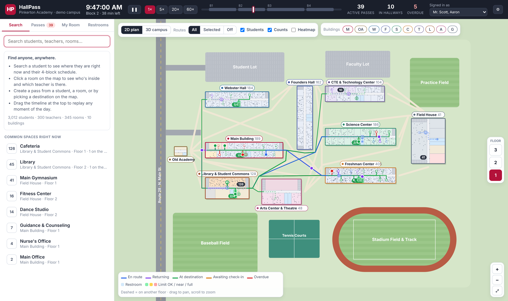
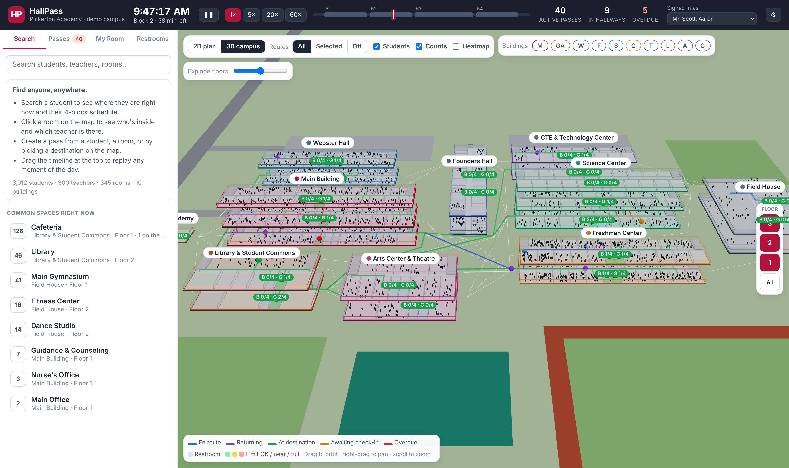

# HallPass — campus-map hall pass demo

A digital hall-pass system built around a live, interactive map of the school. The demo campus is modeled on
**Pinkerton Academy (Derry, NH)**. The buildings, floor plans, students and teachers are all **fictional**
and generated for the demo. Only the "Old Academy" (the original 1815 schoolhouse) and Route 28 / North
Main Street come from the real campus.





## What it does

| | |
|---|---|
| **Live campus map (2D)** | Top-down plan of all 10 buildings with every room, corridor, stairwell and restroom. Pick a floor (1–3) to see that floor across campus. Pan and zoom. Hover a building to see **all of its floor plans side by side** with live headcounts, then click one to jump there. |
| **3D campus** | Orbitable 3D model with stacked floors. Use the *Explode floors* slider to pull floors apart and look inside. Toggle individual floors and buildings. Students show as figures in their rooms, and students on a pass move along their route in real time. |
| **Where is everyone?** | Each of the 3,012 students has a 4-block schedule. Search any student to see where they are now, their schedule, and today's passes. Drag the **timeline** to replay any moment of the day. |
| **Who's in this room?** | Click any room to see the teacher there this block, everyone inside, students on the way, and the room's schedule. |
| **Create passes** | From a student, a room, or a teacher. Set the destination by typing (room number, name or teacher) or with **📍 Pick on map**, which shows the teacher assigned to each room on hover. Destinations can be a room or a teacher; a teacher resolves to wherever that teacher is this block. |
| **Pass lifecycle** | *Round trip* (restroom, nurse, library): out → at destination → returning, and the sending teacher ends it. *One way* (to another teacher/office): the **receiving teacher checks the student in**, and the student stays there for the rest of the block. Passes that run past their expected time are flagged **overdue**. All passes end automatically at the end of the block. |
| **Routes** | Each open pass draws the walking route (corridors, stairs, outdoor walkways) along with the student's live position, name, and the time they left. Show all routes, only the selected one, or none. Segments on other floors are dashed. |
| **Occupancy & limits** | Headcount badges on every room. Restrooms are color-coded green/amber/red against their limit. Set a default restroom limit, or a limit on any room. Passes to a full room warn the teacher before they are created. Optional occupancy **heatmap**. |
| **Teacher view** | *My Room*: students in the room, arrivals waiting for check-in, students who are out, and one-click restroom passes. |
| **Multi-user (demo)** | "Signed in as" is per browser tab, and passes sync between tabs. Open two tabs as two teachers, send a student from one, and check them in from the other. |

## Running it

```bash
npm install
```

```bash
npm run dev
```

Then open the printed URL (default http://localhost:5173).

Other scripts:

```bash
npm run build      # type-check + production build into dist/
```

```bash
npm run validate   # sanity-check the generated school (schedules, capacities, routes, passes)
```

The production build is a static site (`dist/`) with no backend. It can be hosted anywhere, e.g. GitHub Pages.

### Demo controls

* **Clock**: the demo opens at 9:47 AM in Block 2 and runs in real time. Use ⏸, the 1×/5×/20×/60× speeds, or drag
  the timeline. The ⚙ menu jumps to any block, toggles the simulated background traffic, and resets the demo.
* **Background traffic**: about 1,200 simulated passes are spread across the day so the map is never empty.
  You can check in and end these like real passes. The passes you create are marked ★.

## The demo school

| | |
|---|---|
| Buildings | Main Building (3 fl), Old Academy, Webster Hall, Founders Hall, Science Center (3 fl), Freshman Center, CTE & Technology Center, Library & Student Commons (cafeteria + library), Arts Center & Theatre, Field House |
| Rooms | 345 (286 teaching spaces, 42 restrooms, offices, nurse, guidance, gyms, theatre…) |
| People | 3,012 students (grades 9–12), 300 teachers in 11 departments |
| Bell schedule | B1 7:25–8:52 · B2 8:58–10:25 · B3 10:31–12:31 · B4 12:37–2:05 |
| Teachers | Each teacher teaches 3 blocks, mostly in a home room. The 4th block is planning, or study-hall duty in the cafeteria or library. ~38 "floating" teachers borrow rooms during other teachers' planning blocks. |

All data is generated from a fixed seed (`src/data/*.ts`), so every visitor sees the same school.

## Code tour

```
src/
  data/
    campus.ts   building footprints + floor-plan generator (double-loaded corridors, stairs, restrooms)
    nav.ts      walking graph (corridors, stairs, outdoor visibility graph) + Dijkstra routes
    people.ts   teachers, sections, student schedules
    passes.ts   pass model, lifecycle/state machine, simulated traffic
    world.ts    builds everything once at startup
  state/
    store.ts    zustand stores: shared (passes, clock, limits; localStorage) + per-tab UI
    derive.ts   "where is everyone at time t" snapshot, occupancy, live positions
  map/          Map2D (SVG), Map3D (three.js / react-three-fiber), building preview, tooltips
  components/   top bar, sidebar tabs, detail panels, create-pass form
```

## Toward a real deployment

This is a front-end demo. Turning it into a real product would mean:

* A backend (passes, limits and check-ins behind an API with real-time push). The shared store is already
  shaped like that API.
* Real SIS schedule import (e.g. OneRoster) instead of generated students.
* Real floor plans: swap `campus.ts` for traced CAD/PDF plans (rooms as polygons).
* SSO for teachers, plus student/kiosk modes, audit logs, and FERPA-appropriate data handling.
